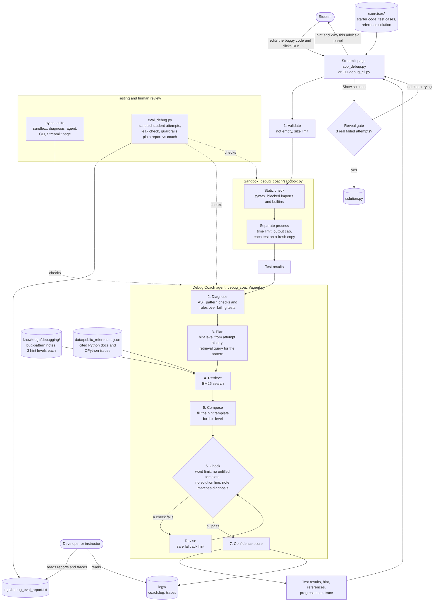

# Debug Coach: A Python Debugging Tutor

Debug Coach runs a student's fix against hidden and visible tests, works out the most likely bug, and gives hints that get more specific each time the student tries again. It uses bug-pattern notes and cited public Python references. It does not give the answer away.

## Original Project

This system extends **Game Glitch Investigator** from Module 1. The original was a Streamlit number guessing game that an AI had written with bugs: the Higher and Lower hints were reversed, the difficulty ranges were wrong, and the score rewarded a wrong guess. The Module 1 goal was to find those bugs, fix them, move the logic into `logic_utils.py`, and cover it with pytest. It ended with three difficulty levels, attempt limits, scoring, working hints, and 18 passing tests. Module 1 was a debugging exercise, so Debug Coach turns that experience into a tool: the buggy game logic is now the hardest exercise (`hard_2_game_logic`). The Module 1 README is in [docs/module1_README.md](docs/module1_README.md) and the reflection is in [reflection.md](reflection.md).

## What Problem This Solves

A failing test tells a student what failed. It does not tell them why. Beginners often stare at "expected 5, got 4" without knowing where to look, or they paste the error into a search box and copy a fix without learning the cause. Instructors cannot give each student a hint on every attempt.

Debug Coach automates that hint step:

- It runs the student's code in a restricted process and reads the test results.
- It names the likely bug pattern, for example a mutable default argument, using the code structure and the failing tests.
- It retrieves the matching note and, for documented Python pitfalls, links the official documentation or the public CPython report.
- It escalates: a question first, then the location, then the technique. The solution is shown only after three real failed attempts.
- It tracks progress and reports a regression when a change breaks a test that passed.

## Where the Exercises Come From

Six short exercises, two each for easy, medium, and hard, all in Python. Each exercise is original code that demonstrates a bug pattern. I did not copy exercise text from websites. That avoids licensing questions and keeps every test case under my control. Where a public source documents the pattern, it is cited and the coach links it.

| Exercise | Level | Bug pattern | Public source |
|---|---|---|---|
| `easy_1_count_vowels` | easy | letter case | None. Original exercise. |
| `easy_2_sum_first_n` | easy | off-by-one in `range` | None. Original exercise. |
| `medium_1_add_item` | medium | mutable default argument | [Python tutorial 4.9.1](https://docs.python.org/3/tutorial/controlflow.html), [CPython issue 26842](https://github.com/python/cpython/issues/71029) |
| `medium_2_remove_negatives` | medium | changing a list while looping over it | [Python tutorial 4.2](https://docs.python.org/3/tutorial/controlflow.html) |
| `hard_1_make_multipliers` | hard | late-binding closure in a loop | [Python FAQ entry](https://mail.python.org/pipermail/python-checkins/2013-January/118793.html), [CPython issue 13094](https://www.python.org/pipermail/docs/2013-January/012247.html) |
| `hard_2_game_logic` | hard | three bugs from the Module 1 game | Module 1 starter, adapted |

I read each source before citing it. One finding changed what I wrote: CPython issue 26842 asked for a longer tutorial explanation and was closed as "won't fix", so the references file describes it as a public report and does not claim the docs changed.

## Architecture Overview

Source: [diagrams/architecture.mmd](diagrams/architecture.mmd). Image: [assets/architecture.png](assets/architecture.png).



1. **Validate.** Empty or oversized submissions are refused.
2. **Sandbox.** A static check blocks syntax errors, risky imports (`os`, `subprocess`, `socket` and others), and builtins such as `open`, `eval`, and `input`. The code then runs in a separate Python process with a 5 second limit, a capped output, and a fresh copy of the file for every test.
3. **Diagnose.** Checks on the code structure (`ast`) find mutable defaults, changes to a list during a loop, late-binding closures, and `range(... - 1)`. Rules over the failing tests find reversed results, letter-case failures, and runtime errors. Anything else is `wrong_value`.
4. **Plan and retrieve.** The hint level comes from the attempt history. BM25 searches two sources: the bug-pattern notes in `knowledge/debugging/` and the cited references in `data/public_references.json`.
5. **Compose and check.** The note's hint for the current level is filled in with the failing test, function, and line. Checks confirm the hint is short, has no unfilled placeholder, contains no line of the reference solution, and comes from a note that matches the diagnosis. A failed check replaces the hint with a plain fallback and lowers the confidence.
6. **Review.** The student sees the hint and a "Why this advice?" panel with the trace. The developer reads `logs/`. `pytest` and `eval_debug.py` test the pipeline.

## Setup

Requires Python 3.10 or newer. Tested on Python 3.13. The Debug Coach uses only the standard library. Streamlit is needed only for the browser page.

Windows (PowerShell):

```
py -m venv .venv
.venv\Scripts\activate
pip install -r requirements.txt
```

macOS or Linux:

```
python3 -m venv .venv
source .venv/bin/activate
pip install -r requirements.txt
```

| Goal | Command |
|---|---|
| List the exercises | `python debug_cli.py list` |
| Start an exercise (creates a file to edit) | `python debug_cli.py start medium_1_add_item` |
| Check your fix and get a hint | `python debug_cli.py check medium_1_add_item` |
| Show the agent trace | `python debug_cli.py check medium_1_add_item --trace` |
| Show the solution (after 3 failed attempts) | `python debug_cli.py reveal medium_1_add_item` |
| Run the scripted demo | `python debug_cli.py demo --brief` |
| Open the browser page | `python -m streamlit run app_debug.py` |
| Run the unit tests | `python -m pytest` |
| Run the evaluation harness | `python eval_debug.py` |

Use `py` instead of `python` on Windows if needed. The `start` command writes your working file to `workspace/`, which is excluded from git.

## Sample Interactions

These outputs come from `python debug_cli.py demo --brief`, which lists only the failing tests. The full run, with every test, is in [logs/debug_sample_run.txt](logs/debug_sample_run.txt). Each scenario is a scripted student.

### 1. Easy: a student repeats a mistake, then makes a different one

The first hint asks a question about one failing test. The same code again gets a pinpoint. A new kind of failure (forgetting the letter u) restarts at level 1.

```
=== Scenario 1: Count the vowels (easy) ===
count_vowels(text) should return how many vowels (a, e, i, o, u, upper or lower case) are in text.

--- Attempt 1: starter code ---
Tests: 3 of 6 pass
  FAIL  all uppercase vowels  (expected 5, got 0)
  FAIL  mixed case word  (expected 5, got 4)
  FAIL  uppercase sentence
Coach, hint level 1 of 3: Test `count_vowels('AEIOU')`: expected 5, got 0. Compare this input with the inputs that pass. What is different about the letters?
  [pattern=case_sensitivity confidence=0.89 sources=patterns#letter-case]

--- Attempt 2: same code again ---
Tests: 3 of 6 pass
  FAIL  all uppercase vowels  (expected 5, got 0)
  FAIL  mixed case word  (expected 5, got 4)
  FAIL  uppercase sentence
Coach, hint level 2 of 3: count_vowels treats uppercase and lowercase letters as different characters. In Python, "A" is not equal to "a".
  [pattern=case_sensitivity confidence=0.89 sources=patterns#letter-case]

--- Attempt 3: forgot the letter u ---
Tests: 3 of 6 pass
  FAIL  all uppercase vowels  (expected 5, got 4)
  FAIL  mixed case word  (expected 5, got 4)
  FAIL  uppercase sentence
Coach, hint level 1 of 3: 3 of 6 tests fail. Start with `count_vowels('AEIOU')`: expected 5, got 4. Work through that input by hand. Where does your code first differ from your hand result?
  [pattern=wrong_value confidence=0.79 sources=patterns#wrong-result]

--- Attempt 4: correct fix ---
Tests: 6 of 6 pass
Progress: 6 of 6 tests pass, up from 3.
Solved: All 6 tests pass. Normalize case before comparing text.
  [pattern=solved confidence=1.0 sources=none]
```

### 2. Medium: the same mistake three times

The hint escalates to the technique, and from level 2 the coach adds links from the second retrieval source.

```
=== Scenario 2: Add an item to a list (medium) ===
add_item(item, items) should return a list that contains item. If a list is passed in, add item to it. If no list is passed in, start a new list each time.

--- Attempt 1: starter code ---
Tests: 4 of 6 pass
  FAIL  second call starts fresh  (expected ['b'], got ['a', 'b'])
  FAIL  three calls start fresh  (expected [3], got [1, 2, 3])
Coach, hint level 1 of 3: Look at `add_item('b')`: expected ["b"], got ["a", "b"]. Something from an earlier call is still there. Where could a value be stored between calls?
  [pattern=mutable_default confidence=0.96 sources=patterns#mutable-default-argument]

--- Attempt 2: same code again ---
Tests: 4 of 6 pass
  FAIL  second call starts fresh  (expected ['b'], got ['a', 'b'])
  FAIL  three calls start fresh  (expected [3], got [1, 2, 3])
Coach, hint level 2 of 3: The default value at line 1 is created once, when the function is defined, and every call shares it. A list or dictionary used as a default keeps its changes.
Read more: CPython issue 26842: tutorial should explain default parameter lifetime (https://github.com/python/cpython/issues/71029)
Read more: Python tutorial, 4.9.1 Default Argument Values (https://docs.python.org/3/tutorial/controlflow.html)
  [pattern=mutable_default confidence=0.96 sources=patterns#mutable-default-argument, ref#cpython-26842, ref#python-tutorial-default-arguments]

--- Attempt 3: same code a third time ---
Tests: 4 of 6 pass
  FAIL  second call starts fresh  (expected ['b'], got ['a', 'b'])
  FAIL  three calls start fresh  (expected [3], got [1, 2, 3])
Coach, hint level 3 of 3: Use None as the default value. Inside the function, create a new list only when the argument is None, then work with that list.
Read more: CPython issue 26842: tutorial should explain default parameter lifetime (https://github.com/python/cpython/issues/71029)
Read more: Python tutorial, 4.9.1 Default Argument Values (https://docs.python.org/3/tutorial/controlflow.html)
  [pattern=mutable_default confidence=0.96 sources=patterns#mutable-default-argument, ref#cpython-26842, ref#python-tutorial-default-arguments]

--- Attempt 4: correct fix ---
Tests: 6 of 6 pass
Progress: 6 of 6 tests pass, up from 4.
Solved: All 6 tests pass. Default values are evaluated once at definition time. Use None as the default and build a fresh object inside the function.
  [pattern=solved confidence=1.0 sources=none]
```

### 3. Hard: three bugs in three functions (Module 1 game logic)

The coach reports progress after each fix. Hint levels restart when the failing function changes.

```
=== Scenario 3: Fix the guessing game logic (Module 1) (hard) ===
Three functions from the guessing game have bugs. get_range_for_difficulty: Easy is 1 to 20, Normal is 1 to 50, Hard is 1 to 100, anything else is 1 to 50. check_guess returns (outcome, message): outcome is Win, Too High or Too Low, and the message tells the player to go LOWER after a high guess and HIGHER after a low guess. update_score: a win on attempt n scores 100 - 10*(n+1) with a minimum of 10, and every wrong guess costs 5 points.

--- Attempt 1: starter code ---
Tests: 7 of 12 pass
  FAIL  Normal range  (expected [1, 50], got [1, 100])
  FAIL  Hard range  (expected [1, 100], got [1, 50])
  FAIL  guess too high  (expected ['Too High', 'Go LOWER!'], got ['Too High', 'Go HIGHER!'])
  FAIL  guess too low  (expected ['Too Low', 'Go HIGHER!'], got ['Too Low', 'Go LOWER!'])
  FAIL  wrong guess on an even attempt  (expected 15, got 25)
Coach, hint level 1 of 3: Test `check_guess(60, 50)`: expected ["Too High", "Go LOWER!"], got ["Too High", "Go HIGHER!"]. The answer is the opposite of what is needed. Which branch of check_guess handles this input?
  [pattern=inverted_condition confidence=0.91 sources=patterns#inverted-condition-or-swapped-result]

--- Attempt 2: fixed check_guess only ---
Tests: 9 of 12 pass
  FAIL  Normal range  (expected [1, 50], got [1, 100])
  FAIL  Hard range  (expected [1, 100], got [1, 50])
  FAIL  wrong guess on an even attempt  (expected 15, got 25)
Progress: 9 of 12 tests pass, up from 7.
Coach, hint level 1 of 3: 3 of 12 tests fail. Start with `get_range_for_difficulty('Normal')`: expected [1, 50], got [1, 100]. Work through that input by hand. Where does your code first differ from your hand result?
  [pattern=wrong_value confidence=0.79 sources=patterns#wrong-result]

--- Attempt 3: also fixed the ranges ---
Tests: 11 of 12 pass
  FAIL  wrong guess on an even attempt  (expected 15, got 25)
Progress: 11 of 12 tests pass, up from 9.
Coach, hint level 1 of 3: 1 of 12 tests fail. Start with `update_score(20, 'Too High', 2)`: expected 15, got 25. Work through that input by hand. Where does your code first differ from your hand result?
  [pattern=wrong_value confidence=0.79 sources=patterns#wrong-result]

--- Attempt 4: correct fix ---
Tests: 12 of 12 pass
Progress: 12 of 12 tests pass, up from 11.
Solved: All 12 tests pass. Check each branch against the specification, one input at a time.
  [pattern=solved confidence=1.0 sources=none]
```

### 4. Guardrails

Code that cannot run is stopped with a message. The solution is refused until the student has made three real attempts.

```
=== Scenario 4: guardrails ===

--- syntax error ---
Tests: 0 of 6 pass
  The tests could not run (syntax_error): invalid syntax
Coach, hint level 1 of 3: Python could not read your code, so no test ran. Read the error message. It points near line 1.
  [pattern=syntax_error confidence=1.0 sources=errors#syntax-error]

--- blocked import ---
Tests: 0 of 6 pass
  The tests could not run (blocked): import of 'os' is not allowed in exercises
Coach, hint level 1 of 3: The checker blocked something in your code: import of 'os' is not allowed in exercises.
  [pattern=blocked_code confidence=1.0 sources=errors#blocked-code]

--- starter code, still buggy ---
Tests: 4 of 6 pass
  FAIL  second call starts fresh  (expected ['b'], got ['a', 'b'])
  FAIL  three calls start fresh  (expected [3], got [1, 2, 3])
Progress: 4 of 6 tests pass, up from 0.
Coach, hint level 1 of 3: Look at `add_item('b')`: expected ["b"], got ["a", "b"]. Something from an earlier call is still there. Where could a value be stored between calls?
  [pattern=mutable_default confidence=0.96 sources=patterns#mutable-default-argument]

--- asking for the solution too early ---
Try 2 more time(s) before viewing the solution. Each run gives a new hint.

--- asking for the solution after 3 failed attempts ---
def add_item(item, items=None):
    """Return a list that contains item.

    If items is given, add item to it. If it is not given, start a new list.
    """
    if items is None:
        items = []
    items.append(item)
    return items
```

## Reliability and Guardrail Results

| Guardrail | What it does | Where it is tested |
|---|---|---|
| Static code check | Blocks syntax errors, risky imports, and `open`, `eval`, `exec`, `input` | `tests/test_debug_sandbox.py`, harness |
| Time and output limits | A 5 second limit stops infinite loops. Printed output is truncated | `tests/test_debug_sandbox.py`, harness |
| Input check | Refuses empty and oversized submissions | `tests/test_debug_agent.py`, harness |
| No solution leak | Rejects any hint that contains a line of the reference solution. A control test proves the check can fail | `tests/test_debug_agent.py`, harness |
| Note must match the diagnosis | A note for a different pattern is not used | `tests/test_debug_agent.py`, harness |
| Safe fallback | A failed check replaces the hint with a plain one and lowers confidence | `tests/test_debug_agent.py`, harness |
| Reveal gate | The solution needs 3 real failed attempts. Empty submissions do not count | `tests/test_debug_agent.py`, harness |
| Hidden tests | Hidden inputs and expected values are never shown | `tests/test_debug_sandbox.py` |
| Logging | `logs/coach.log` records each decision and each revision | `coach/log.py` |

Unit tests:

```
$ python -m pytest -q
........................................................................ [ 41%]
........................................................................ [ 83%]
.............................                                            [100%]
173 passed
```

Evaluation harness, summary (`python eval_debug.py --summary`). The full report with every check is in [logs/debug_eval_report.txt](logs/debug_eval_report.txt).

```
$ python eval_debug.py --summary
DEBUG COACH EVALUATION
======================================================================

  exercises    6/6 passed
  diagnosis    20/20 passed
  retrieval    15/15 passed
  escalation   7/7 passed
  leak         2/2 passed
  sandbox      10/10 passed
  reveal       5/5 passed
  fallback     3/3 passed
  progress     2/2 passed

HINT STYLE: plain test report vs coach, 6 exercises
----------------------------------------------------------------------
                     avg words  asks a question  names function/line  quotes a test input
Plain test report         13.5               0%                   0%                   0%
Coach hint level 1        25.3             100%                 100%                 100%
Coach hint level 2        26.3              17%                 100%                   0%
Coach hint level 3        30.8               0%                   0%                   0%

CONFIDENCE over 13 failing scripted attempts: average 0.88, lowest 0.79

======================================================================
RESULT: 70/70 checks passed
```

## Stretch Features

All four optional features are included.

| Feature | Where | Evidence |
|---|---|---|
| RAG enhancement: multiple sources | Bug-pattern notes plus cited public references | Before and after below |
| Agentic workflow enhancement | `debug_coach/agent.py` | Traces in [ai_interactions.md](ai_interactions.md) and [logs/debug_sample_traces.jsonl](logs/debug_sample_traces.jsonl) |
| Specialization: constrained tutoring style | Tiered, Socratic hints that never give the solution | Style comparison below |
| Test harness | `eval_debug.py` | Summary above |

**RAG enhancement, before and after.** The same submission (`medium_1_add_item` starter, second attempt) with the notes alone and then with the notes plus the public references. The hint is the same. The second source adds links the student can read.

```
Notes only:
  hint: The default value at line 1 is created once, when the function is defined, and every call shares it. A list or dictionary used as a default keeps its changes.
  references: none

Notes plus public references:
  hint: The default value at line 1 is created once, when the function is defined, and every call shares it. A list or dictionary used as a default keeps its changes.
  references: Python tutorial, 4.9.1 Default Argument Values
              CPython issue 26842: tutorial should explain default parameter lifetime
```

**Specialization, measured against a plain test report.** The baseline is what a student sees without the coach: the number of failing tests and the first failing test with its expected and actual values. Each row covers the six exercise starters.

```
HINT STYLE: plain test report vs coach, 6 exercises
----------------------------------------------------------------------
                     avg words  asks a question  names function/line  quotes a test input
Plain test report         13.5               0%                   0%                   0%
Coach hint level 1        25.3             100%                 100%                 100%
Coach hint level 2        26.3              17%                 100%                   0%
Coach hint level 3        30.8               0%                   0%                   0%
```

Level 1 asks a question about a specific test. Level 2 names the function or line. Level 3 names the technique and asks nothing. The plain report does none of these. The measures are computed from the diagnosis in `eval_debug.py`, not from keywords in the hint.

## Design Decisions

- **Original exercises, cited sources.** The shell used to build this has no internet access, and copying exercise text raises licensing questions. Short original exercises with verified citations are reproducible and safe to publish. The cost is that there are only six.
- **Rules and the `ast` module instead of a model for diagnosis.** Static checks find the documented patterns reliably and explain themselves. The cost is coverage: a bug outside the rules is labeled `wrong_value` with a generic hint.
- **BM25 instead of embeddings.** The corpus is 17 short documents. BM25 needs no packages and gives the same result every time. The cost is that it matches words, not meaning.
- **Hints written ahead of time, filled in with live data.** Each note has three hint levels. The agent fills in the failing test, function, and line. The hint cannot invent facts about the code.
- **The solution is guarded by a leak check, not hidden.** `solution.py` is in the repository, so a student can read it. The reveal gate and the leak check are teaching aids, not security.
- **Confidence is a heuristic.** It combines the output checks, how well the note matched, and the diagnosis confidence. It is not a calibrated probability.
- **No model by default.** Everything runs offline and gives the same result every time. A language model could write more natural hints but would need an API key and would need the same leak check.

## Testing Summary

- **What worked.** 173 unit tests pass. The harness passes 70 of 70 checks. All 6 starters fail some tests, and all 6 solutions pass every test. The coach diagnosed 19 of 19 scripted attempts as expected. That includes a correct fix written differently from the reference solution, which is accepted.
- **What the harness caught.** My first letter-case rule fired on the game exercise because inputs like `'Normal'` contain a capital letter. It misdiagnosed two attempts. I changed the rule to fire only when uppercase text separates the failing tests from the passing ones. I also dropped an early "numbers differ by 1" rule that would have mislabeled a forgotten vowel as off-by-one. Empty submissions could unlock the solution until a test showed it, and now they do not.
- **What is weak.**
  - The 19 scripted attempts are ones I wrote while building the rules, so 19 of 19 overstates how the coach would do on real student code. No real students have used it.
  - When the bug is a wrong constant or condition, as in the ranges and the score in `hard_2_game_logic`, the hint is the generic "work through it by hand".
  - Confidence is 0.79 to 0.96 on failing attempts, so it separates little.
- **What is not tested.** The browser page was tested against a stand-in for the Streamlit API. I could not install Streamlit in the build environment, so a manual run is needed: `python -m streamlit run app_debug.py`. The sandbox blocks common risks. It is not a security boundary, so only run code you wrote.

## Earlier Iteration: Glitch Coach for the Guessing Game

The first version of this project added a hint coach to the Module 1 game itself. It is still in the repository: `app.py`, `demo.py`, `eval_harness.py`, `coach/`, `knowledge/`, and [diagrams/game_coach_architecture.mmd](diagrams/game_coach_architecture.mmd). It retrieves strategy notes and simulated past-game statistics, passes 43 of 43 harness checks, and showed that the Hard difficulty cannot be won more than about 31% of the time. I moved the main project to Debug Coach because debugging is a more useful task than guessing a number. The retriever from `coach/` is shared by both.

## Reflection

The most useful step was making the coach fail on purpose. The checks matter only if they can fail, so the leak check has a control test, the fallback path is tested with a broken note, and the scripted attempts include wrong fixes as well as right ones. Two misdiagnoses showed up only because those attempts were there. I also learned to verify sources before citing them: one public report I planned to cite as a documentation change was closed as "won't fix".

Planned improvements are listed in [model_card.md](model_card.md#future-improvements), next to the graded responsible-AI reflection.

## Portfolio Entry

Code: https://github.com/brichards2014/ai-game-system

I turn a small debugging exercise into a tutoring tool with checks around it: a restricted code runner, hints that cannot contain the answer, cited sources, and a harness that tests wrong attempts as well as right ones. I report the weak results next to the good ones.

## Repository Layout

```
debug_cli.py            Command-line Debug Coach and scripted demo
app_debug.py            Streamlit page for the Debug Coach
eval_debug.py           Evaluation harness for the Debug Coach
debug_coach/            sandbox.py, diagnose.py, agent.py, guardrails.py, exercises.py, scripted.py
exercises/              Six exercises: starter.py, solution.py, exercise.json (test cases)
knowledge/debugging/    Bug-pattern notes with three hint levels
data/public_references.json   Cited Python docs and CPython issues
coach/                  Shared retriever and logging, plus the earlier game coach
app.py, demo.py, eval_harness.py, logic_utils.py   Module 1 game and the earlier Glitch Coach
tests/                  pytest suite
diagrams/               architecture.mmd (Debug Coach), game_coach_architecture.mmd
assets/                 PNG exports of the diagrams
logs/                   Sample runs, traces, and evaluation reports
docs/                   Module 1 README
model_card.md           Limitations, misuse, surprises, AI collaboration
ai_interactions.md      Prompt log and agent reasoning traces
```

